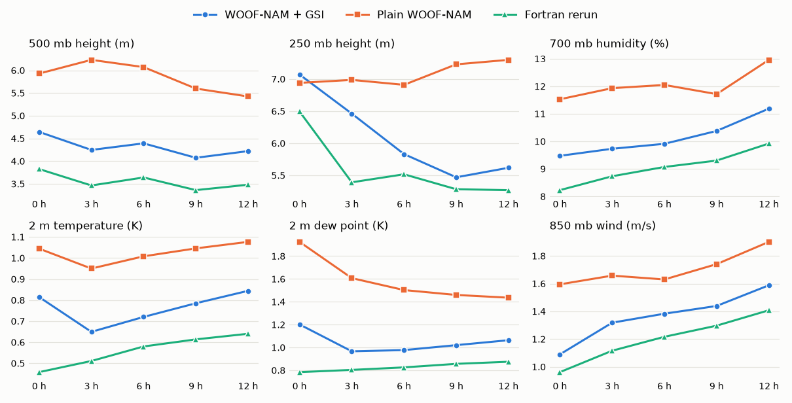
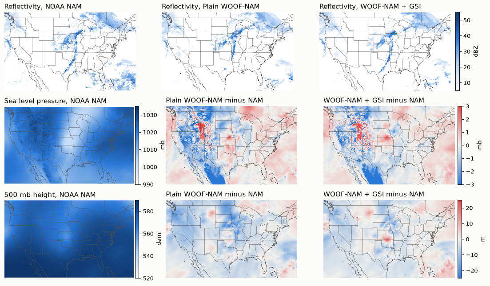

# Pirate NAM benchmarks

Detail behind the [README](README.md): how close Pirate NAM gets to the archived NAM, what each test decided, and what a live run costs.

## Closeness to the NAM

All scores are RMSE against the archived NAM forecast for the 00Z 3 November 2026 cycle, on the NAM's own output grid, to 12 hours. Lower means closer to the NAM.

- Pirate NAM's median error is **0.84×** plain WOOF-NAM from GFS, and it's closer to the NAM on **68 of 69** scores. That ratio runs from 0.81 at hour 0 to 0.86 at hour 12.
- Its median error is **1.19×** our Fortran rerun of the NAM.
- Live inputs cost **2.7%** in median error against the same cycle on the NAM's own observation files. Sea level pressure, low-level fields and humidity lose the most, while upper-level heights are slightly closer.

### Scores at 12 hours

| Field | Pirate NAM | With NAM's files | Plain GFS start | Fortran rerun | WOOF from NAM analysis |
|---|--:|--:|--:|--:|--:|
| 500 mb height (m) | **4.15** | 4.22 | 5.42 | 3.48 | 0.96 |
| 250 mb height (m) | **5.50** | 5.62 | 7.30 | 5.27 | 1.45 |
| 700 mb humidity (%) | **11.45** | 11.19 | 12.96 | 9.92 | n/a |
| 2 m temperature (K) | **0.87** | 0.84 | 1.08 | 0.64 | 0.36 |
| 2 m dew point (K) | **1.10** | 1.06 | 1.44 | 0.87 | 0.33 |
| 850 mb wind (m/s) | **1.64** | 1.59 | 1.90 | 1.41 | 0.49 |
| 10 m wind (m/s) | **0.83** | 0.83 | 0.96 | 0.69 | 0.32 |
| 250 mb wind (m/s) | **2.76** | 2.66 | 3.14 | 2.60 | 0.52 |
| Composite reflectivity (dBZ) | **11.34** | 11.31 | 12.06 | 10.09 | 8.45 |
| Precipitation (mm) | **3.18** | 3.12 | 4.15 | 3.18 | 0.80 |
| Sea level pressure (Pa) | **50.4** | 46.5 | 57.5 | n/a | 25.2 |

- **Pirate NAM:** WOOF-NAM from GFS with three GSI analyses, using only inputs a live run can get.
- **With NAM's files:** the same cycle using the NAM's final observation files, which ended with the NAM.
- **Plain GFS start:** WOOF-NAM from GFS, with no analyses.
- **Fortran rerun:** the original Fortran NAM and GSI rebuilt with gfortran on the same substitute inputs, with land seeded from the NAM's archive.
- **WOOF from NAM analysis:** WOOF-NAM started from the NAM's own archived analysis. This tests the port itself and isn't something a live system could do.

### How to read this

- **This is one case.** Other weather could score differently.
- **Close to the NAM isn't the same as accurate.** These scores don't compare any of the runs with observations. The NAM's own errors count as the truth here, and the NAM also used GSI, which favours the GSI cycle on this measure.
- **The Fortran rerun has an advantage near the surface:** its land was seeded from the same archive it's scored against. A live run couldn't do that.

### Maps at 12 hours

Valid 12Z 3 November 2026. Red is higher than the NAM and blue is lower. The noisy pressure differences over the western mountains appear in both WOOF-NAM runs, and sea level pressure is an extrapolated quantity there.

## How long the observations help

This test used the NAM's own observation files and was scored to 36 hours, so hours 36 to 84 have no score against the NAM. The median ratio is the GSI cycle's error relative to a plain GFS start: below 1 means closer to the NAM. Below that, each cell is RMSE for the GSI cycle / plain start.

| Field | 0 h | 6 h | 12 h | 18 h | 24 h | 30 h | 36 h |
|---|--:|--:|--:|--:|--:|--:|--:|
| **Median ratio, all fields** | **0.78** | **0.81** | **0.82** | **0.83** | **0.87** | **0.87** | **0.87** |
| 500 mb height (m) | 4.64 / 5.93 | 4.38 / 6.07 | 4.22 / 5.42 | 4.68 / 5.94 | 4.96 / 6.33 | 5.47 / 6.99 | 6.27 / 8.53 |
| 250 mb height (m) | 7.07 / 6.94 | 5.82 / 6.91 | 5.60 / 7.30 | 6.49 / 8.29 | 7.39 / 9.66 | 8.71 / 11.62 | 10.36 / 13.86 |
| 700 mb humidity (%) | 9.48 / 11.53 | 9.90 / 12.05 | 11.19 / 12.96 | 12.40 / 13.97 | 13.86 / 15.80 | 15.41 / 16.39 | 15.98 / 17.21 |
| 2 m temperature (K) | 0.81 / 1.04 | 0.72 / 1.01 | 0.85 / 1.08 | 0.99 / 1.19 | 0.89 / 1.00 | 0.89 / 1.04 | 1.06 / 1.20 |
| 2 m dew point (K) | 1.20 / 1.92 | 0.98 / 1.50 | 1.06 / 1.44 | 1.15 / 1.40 | 1.21 / 1.42 | 1.15 / 1.35 | 1.20 / 1.37 |
| 850 mb wind (m/s) | 1.09 / 1.60 | 1.39 / 1.63 | 1.59 / 1.90 | 1.73 / 1.99 | 1.70 / 1.89 | 1.85 / 2.10 | 1.97 / 2.25 |

## What each test decided

Each row changes one thing from the GSI cycle on the NAM's own files, on the same case. A ratio below 1 means closer to the NAM.

| Change | Median error ratio | Closer on | Decision |
|---|--:|--:|---|
| Live inputs: RAP's files, no GPS radio occultation | 1.027 | 16 of 69 | **Used.** It's the only option live |
| Land seeded from the NAM archive | 0.997 | 53 of 69 | Not used. A small gain, and a live run has no archive to seed from |
| Start from a Fortran NAM cycle's analysis | 0.969 | 54 of 69 | Not used. Needs a Fortran model run as well |
| Digital filter after each analysis | 1.001 | 33 of 69 | Not used. No gain, and hour 0 2 m temperature got worse |
| Start from RRFS instead of GFS | 1.167 | 1 of 69 | Not used. Much further from the NAM |

Three other choices come from separate comparisons:

- **Radiances:** 0.999 median ratio, closer on 51 of 89 scores, tested in the Fortran rerun. Left out.
- **Lightning:** 1.000 median ratio, closer on 43 of 89 scores, tested in the Fortran rerun on top of radiances. Left out.
- **Number of analyses:** seven analyses scored 0.824× a plain GFS start and four scored 0.817×, so seven were no closer. Both tests started from a Fortran analysis and predate the fix that reloads lateral boundaries after each analysis, and neither was repeated afterwards.

## The first live run

The 12Z 5 November 2026 cycle, on a two-card t2-90 machine already set up. The first attempt at this cycle failed at the handoff to the forecast and was fixed; these times are from the run that completed. The forecast itself was later withdrawn because of the sun-angle bug described below, but these times still stand: the 18Z run with the fix took 73 min for the forecast and 17 min to build and upload.

| Step | Time | Notes |
|---|--:|---|
| Inputs | 27 min | RAP observations, MRMS radar, GEFS ensemble, boundaries. GFS was reused from the failed attempt, where it took another 4.5 min |
| Catch-up with 3 GSI analyses | 45 min | GSI took 661, 664 and 691 s on 28 CPU cores, with a peak of 39 GB |
| 84-hour forecast on two cards | 74 min | 53 s per forecast hour, including writing output |
| Build and upload | 17 min | |
| **Total** | **2 h 43 min** | **About CAD 6.30** at CAD 2.32 an hour, or about CAD 6.50 with the GFS download. Machine setup isn't counted |

Output was 85 GRIB2 files of about 43 MB each and a 679 MB Zarr store.

### Compared with GFS

There's no NAM left to score a live run against, so this compares the 18Z 5 November 2026 run, on WOOF-NAM 0.1.3 with the sun-angle fix, with the 18Z GFS at the same valid times. GFS isn't the truth, and the two models should drift apart, so this is a check for problems and not a skill score. Each cell is RMSE, with the mean difference in brackets.

| Field | 0 h | 12 h | 24 h | 48 h | 84 h |
|---|--:|--:|--:|--:|--:|
| 500 mb height (m) | 4.16 (-1.52) | 5.51 (-0.23) | 6.78 (+0.38) | 13.31 (-1.63) | 20.16 (-1.60) |
| Sea level pressure (mb) | 0.93 (-0.12) | 1.07 (+0.12) | 1.32 (+0.25) | 1.90 (+0.15) | 2.42 (+0.26) |
| 850 mb temperature (K) | 0.73 (-0.08) | 0.98 (-0.08) | 1.21 (-0.00) | 1.38 (-0.08) | 1.54 (-0.11) |
| 2 m temperature (K) | 1.33 (-0.16) | 1.70 (-0.28) | 1.95 (-0.65) | 2.19 (-0.77) | 2.32 (-0.61) |

**Sun-angle bug, now fixed.** The first live run grew steadily colder than GFS, reaching -3.25 K at 2 m by hour 84 on the NAM's output grid, and -5.12 K over land. The handoff from catch-up to forecast kept a cached start hour, so the sun angle that scales shortwave heating ran 6 hours behind and US morning warming began 6 hours late. With the fix, warming starts within an hour of GFS in every US longitude band checked, and that run has been removed.

**The fixed run is still a little colder than the archive.** These numbers are on the NAM's output grid at hour 84, valid 06Z, each against its own cycle's GFS. The archive range is three 18Z NAM cycles from 28 October to 1 November 2026, so the weather differs.

| Mean difference from GFS (K) | Pirate NAM | Archived NAM |
|---|--:|--:|
| 2 m temperature, land | -0.82 | -0.58 to -0.12 |
| 2 m temperature, sea | -0.95 | -0.55 to -0.44 |
| 850 mb temperature | -0.20 | -0.41 to -0.13 |

2 m air over water is the clearest remaining gap, and evening cooling over the western US is about twice GFS's rate. Causes aren't established, and one cycle can't show whether these persist. The scores against the NAM above come from a test cycle run before this fix and before WOOF-NAM 0.1.3. They stop at 12 hours, on a 00Z cycle that's mostly overnight in North America, and haven't been rerun.

### Estimated costs for other setups

| 84-hour forecast | Time | Cost (OVHcloud) | Status |
|---|---|---|---|
| GSI cycle, one card (t2-45) | About 3.2 h | About CAD 3.70 | Estimated from measured parts |
| WOOF-NAM from GFS, one card | About 2.2 h | About CAD 2.55 | Scaled from a measured 48-hour run |

These cover the model and GSI only, not fetching inputs, building products or uploading.

## Full comparison

| | NOAA NAM v4.2 | WOOF-NAM as released | Pirate NAM |
|---|---|---|---|
| **Status** | Retired 3 Nov 2026 | Open source | Experimental |
| **Model** | NMMB, Fortran | Same design, ported to GPU | WOOF-NAM, unchanged |
| **Numerics** | The reference | Single precision, not bit-identical to the NAM | Same as WOOF-NAM |
| **Hardware** | Supercomputer | One or more NVIDIA cards | Two V100S cards, 30 CPUs, 90 GB. One card, 15 CPUs and 45 GB also works, more slowly |
| **Grids** | 12 km parent plus higher-resolution nests | 12 km; 4 km, nests and others available | 12 km only |
| **Forecast length** | 84 h at 12 km | Your choice | 84 h |
| **Start** | Global model atmosphere plus NAM's own land, 6 h before the forecast | GFS, or a NAM analysis when one exists | GFS, 6 h before the forecast |
| **Analyses** | GSI every hour through the catch-up (7 analyses) | None | GSI every 2 hours (3 analyses) |
| **Observation sources** | NAM's dedicated data feed, satellite radiances, radar | None | RAP's hourly observation files and MRMS radar, since the NAM's own files ended with it. RAP's files have no GPS radio occultation. Radiances and lightning left out |
| **Ensemble in GSI** | Global ensemble | None | GEFS, the newest available |
| **Digital filter** | At each catch-up start | At the start | At the start only |
| **Soil and snow** | Carried from cycle to cycle, with observed rainfall | From GFS | From GFS |
| **SST and sea ice** | Refreshed from outside analyses | From GFS | From GFS |
| **Lateral boundaries** | GFS cycle 6 h older than the forecast | GFS cycle 6 h older than the start | GFS cycle 6 h older than the forecast |
