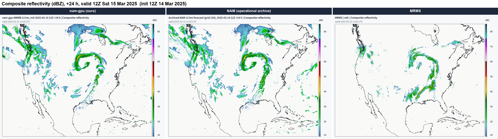
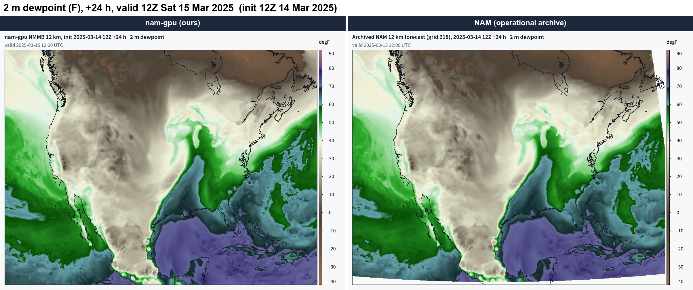
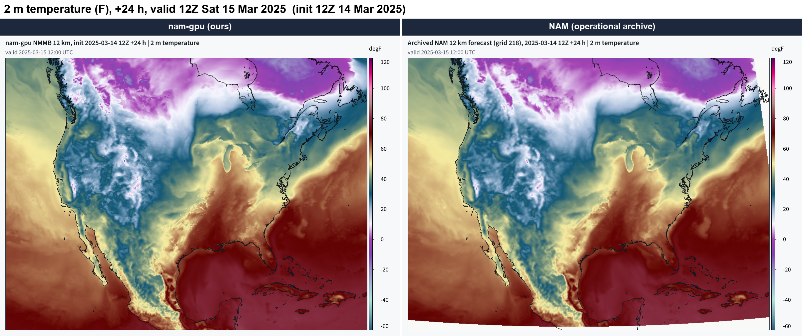
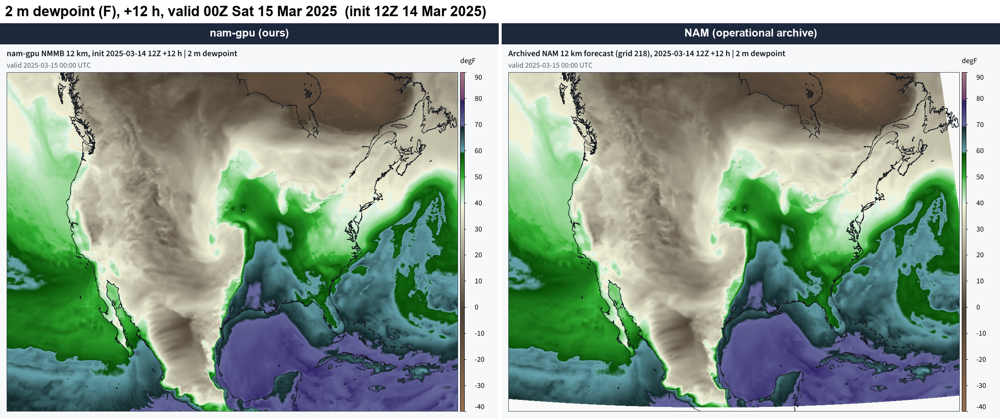
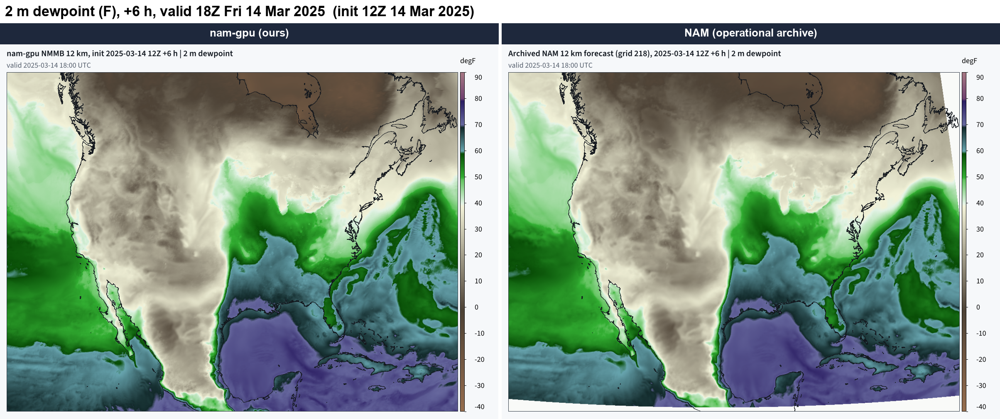

# woof-nam

A GPU port of NOAA/NCEP's North American Mesoscale model (NAM, nam.v4.2.11): the NMMB
(Nonhydrostatic Multiscale Model on the B grid) dynamics and the NAM's operational physics,
running on one NVIDIA card. NCEP retired the NAM on 2026-11-03 12Z; this package keeps the model
running.

## What it looks like

The 2025-03-14 12Z case: woof-nam (left), the archived operational NAM 12 km forecast of the same cycle
(middle) and MRMS observed composite reflectivity (right), at the same valid time.



*Composite reflectivity, +24 h, valid 12Z 15 Mar 2025. Ours | NAM | MRMS, same colour scale. Both
models wrap the comma head over the upper Midwest; both our run and the real NAM put the trailing line
west of the observed one, and neither has MRMS's second band across Mississippi and Alabama.*

Surface fields, ours (left) | NAM (right), same colour scale (MRMS has no surface fields):



*2 m dewpoint, +24 h, valid 12Z 15 Mar 2025. Ours | NAM, same colour scale.*



*2 m temperature, +24 h, valid 12Z 15 Mar 2025. Ours | NAM, same colour scale.*



*2 m dewpoint, +12 h, valid 00Z 15 Mar 2025. Ours | NAM, same colour scale.*



*2 m dewpoint, +6 h, valid 18Z 14 Mar 2025. Ours | NAM, same colour scale.*

Every map, including our MSLP (the archived NAM set has no forecast MSLP map, so that panel reads
"not available"), is in [docs/evidence/](docs/evidence/).

Private repository. Distribution name `woof-nam`, import name `namgpu`, version 0.1.0. Not on PyPI.

## Scope

- **Domain:** the NAM 12 km CONUS parent (rotated lat-lon B grid, 954 x 835 x 60, 25 s step).
- **Dynamics:** NMMB, ported from the NAM source to CUDA kernels.
- **Physics:** the NAM's suite, all on the GPU:
  - Ferrier-Aligo microphysics;
  - Betts-Miller-Janjic convection;
  - MYJ boundary layer and the Janjic surface layer;
  - Noah land surface;
  - RRTM longwave and shortwave (NCEP's RRTMG, hourly);
  - Janjic gravity-wave drag (GMTED2010 terrain).
- **Start sources:** the archived NAM native analysis (`bgrd3d00`, for cycles before the
  retirement) or GFS 0.25 degree for any date. GFS supplies the lateral boundaries on the GFS start;
  the native start uses the NAM's own boundary files.
- **Not bitwise with the NAM.** The port runs in single precision with fast numerics. It is judged
  by whole wet forecasts beside the archived NAM forecast of the same cycle and MRMS reflectivity.

## Speed and memory (one RTX PRO 6000, 96 GB)

- **24 h forecast:** 643 s at 186 ms per step (native start, all physics), which is about 21 min
  per 48 h at that rate. The one measured 48 h run, on an earlier tree with the card shared,
  took 2,734 s (395.5 ms per step) and finished with every field finite.
- **Memory:** the forecast's own pool is about 58 GB today; the card peaked at 75 GB in the 24 h
  run.

## Evidence

Side-by-side maps for the 2025-03-14 12Z case are in [docs/evidence/](docs/evidence/): ours, the
archived NAM and MRMS at +6, +12 and +24 h.

## Install

Needs Linux, an NVIDIA card with more than 58 GB of memory (it was run on a 96 GB RTX PRO 6000), CUDA 13, Python 3.12+, and gpuwm 2.9.11 (it
supplies the Rust GRIB2 decoder, the NetCDF writer and the map renderer `rw_wrfbatch`).

```
python -m venv .venv && source .venv/bin/activate
pip install -e .                       # cupy-cuda13x, numpy, scipy, netCDF4, Pillow, gpuwm
tools/fetch_fix.sh                     # NOAA radiation, CO2 and ozone fix files into fix/
source env.sh                          # NAMGPU_ROOT, GPUWM_BRIDGES, NAMGPU_GEOG
```

GMTED2010 terrain for gravity-wave drag is read from a WPS geog set (`topo_gmted2010_30s`) under
`NAMGPU_GEOG` (default `~/WPS_GEOG`).

## Run one forecast

```
python -m namgpu.init.init_fetch_case --cycle 2025031412 --hours 24 --case-dir cases/2025-03-14_12z
python tools/run_forecast.py --case 2025-03-14_12z --source native --hours 24 --out runs/2025-03-14_12z
```

`--source gfs` starts from GFS instead. The run writes hourly wrfout-shaped history, maps from the
Rust renderer, and `forecast-receipt.json` (init time, ms per step, per-stage timing, end-of-run
finite check).

## Layout

```
namgpu/            the package: config, grid, state, kernels/ (one .cu per unit), dynamics/,
                   boundary/, physics/, init/, io/, steps/, driver.py
tools/             run, init, extract and check tools; fetch_fix.sh
tests/             smoke_full.py (whole forecast), unit tests
parm/              NAM parm files (NOAA, unmodified)
fix/               fetched NOAA fix files (not committed); fix/noah/ Noah stand-in tables
cases/<case>/      CASE.md and the referee recipe; inputs are fetched, never committed
third_party/arwen/ ArWen (gpuwm) files reused, Apache-2.0
UNITS.json         every port unit and its status
CONTRACT.md        array layout, step order, kernel convention, done rule
```

## Known gaps

- **Nests:** the NAM's nests (CONUS 3 km, Alaska, Hawaii, Puerto Rico, fire weather) are not
  ported; this is the 12 km parent only.
- **Multi-card:** in progress.
- **Memory fit:** in progress. Today the full domain needs about 58 GB, so it does not fit a
  32 GB card.
- **Noah vegetation table:** the NAM's own VEGPARM.TBL was never published. A stand-in built from
  WRF's public-domain table is used (fix/noah/PROVENANCE.txt).

## Licence

Apache-2.0 (LICENSE). Third-party origins and their notices are in NOTICE.
