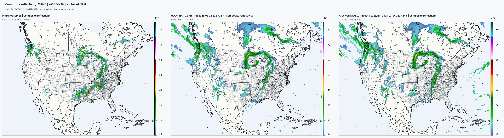
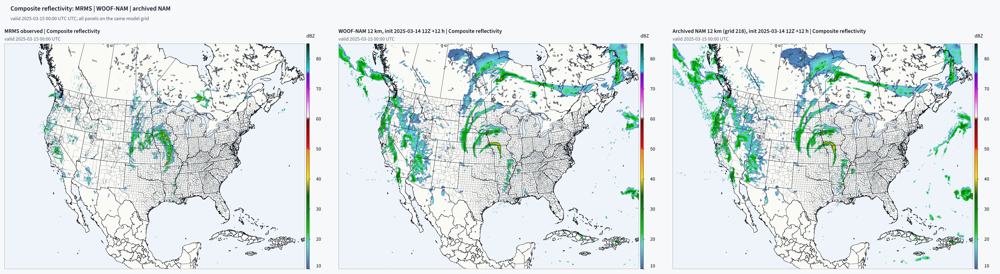
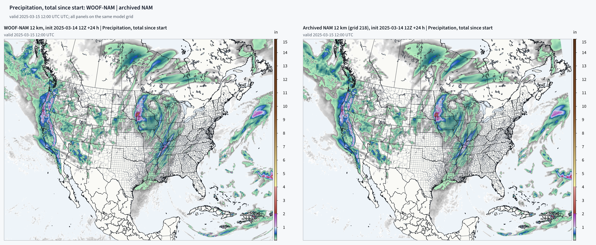
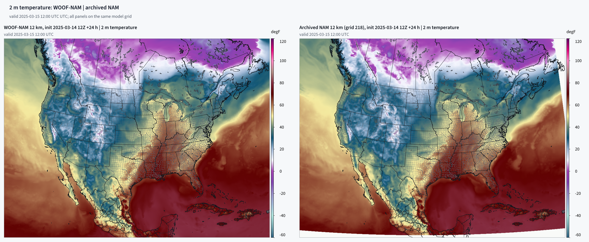
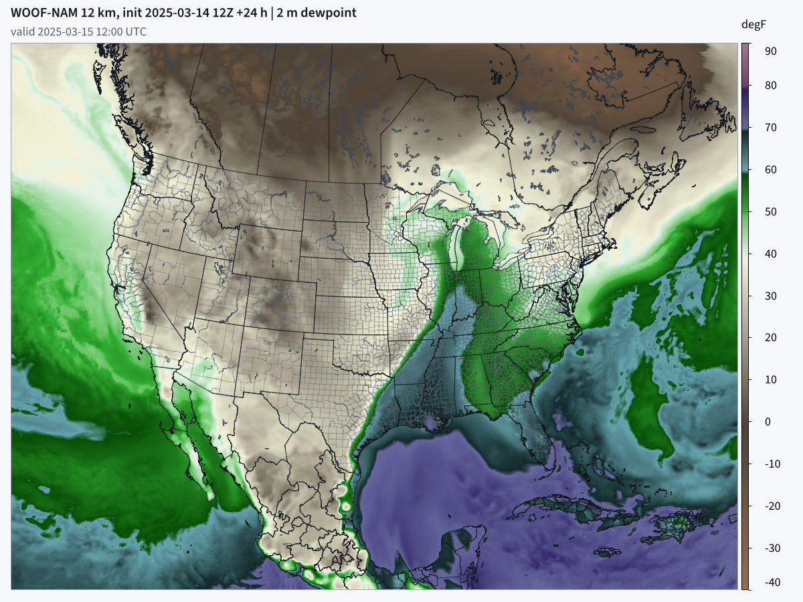

# WOOF-NAM

WOOF-NAM is a GPU port of NOAA/NCEP's North American Mesoscale model (NAM, nam.v4.2.11): the NMMB
(Nonhydrostatic Multiscale Model on the B grid) dynamics and the NAM's operational physics, running
on one NVIDIA card or on several cards of one machine. NCEP retired the NAM on 2026-11-03 12Z; this
package keeps the model running.

Distribution name `woof-nam`, import name `namgpu`, version 0.1.0. Not on PyPI yet: install from GitHub (below) or from the wheel attached to the GitHub release.

## What it looks like

The 2025-03-14 12Z case, run from a fresh clone with `woof-nam run --source native --hours 24` (the NAM
analysis start, the digital filter, every physics scheme on). The sheets come from `woof-nam side-by-side`:
MRMS observed reflectivity, WOOF-NAM and the archived operational NAM 12 km forecast of the same cycle, on
the same map frame and colour scales.



*Composite reflectivity, +24 h, valid 12Z 15 Mar 2025. MRMS | WOOF-NAM | NAM. Like the NAM, WOOF-NAM wraps
the comma head over the upper Midwest and puts the trailing line west of the observed one; neither model
has MRMS's second band across Mississippi and Alabama.*



*Composite reflectivity, +12 h, valid 00Z 15 Mar 2025. WOOF-NAM and the NAM put the same curved line with a
40+ dBZ core over Iowa and Missouri; MRMS has it farther west, over Nebraska and Kansas.*



*Precipitation since the start, +24 h. WOOF-NAM | NAM: the same Pacific coast, upper Midwest and Ohio
Valley maxima.*



*2 m temperature, +24 h. WOOF-NAM | NAM.*



*2 m dewpoint, +24 h, one of the maps every `woof-nam run` draws.*

The +12 h sheets and the other maps are in [docs/evidence/](docs/evidence/).

## What you need

- **Linux** (x86_64) with Python 3.12 or newer.
- **An NVIDIA card with 32 GB (one RTX 5090) or larger; up to 85 GB on a 96 GB card without the fit.** On a
  card with less than 64 GB the run takes the 32 GB fit by itself: arrays that live inside one step are handed
  back after their last user, the radiation working set is dropped between calls and the radiation runs in
  8-row chunks. Every physics scheme stays on. The run log and `forecast-receipt.json` name the memory path
  that ran (`memory path: fit` or `full`); `NAMGPU_MEMORY_PATH=fit` or `full` picks one on any card.
  Fetching data, the static fields, maps and the side-by-side panels need no big card (the static-field
  build uses an NVIDIA card for a few seconds).
- **Or two or more 32 GB cards of one machine** (`woof-nam run --cards N`, see "Running on more than one
  card"): the 12 km grid ran on 2, 4 and 8 RTX 5090 cards at 19-31 GiB per card, with the same bits on any
  number of cards.
- **An NVIDIA driver for CUDA 13.** No system CUDA toolkit is needed: pip installs the CUDA runtime
  and the compiler headers (`cupy-cuda13x[ctk]`). The kernels are compiled on the card at first use
  (NVRTC) and cached.
- **Disk:** 3.7 GB of inputs for a 24 h case (about 7 GB for 48 h), 2 GB for the terrain set,
  and room for the hourly history. The 24 h example case is fetched in about 2.5 minutes on a fast link.
- **Internet access** to NOAA's open-data buckets on AWS (NAM, GFS and MRMS). No account is needed.

## Install

```
python3 -m venv woof-nam-venv && source woof-nam-venv/bin/activate
pip install "woof-nam @ git+https://github.com/recastsystems/woof-nam.git"   # or, in a clone: pip install .
gpuwm fetch-geog --datasets topo_gmted2010_30s --root ~/WPS_GEOG              # GMTED2010 terrain, 174 MB download
```

pip installs `woof-nam` with everything a run reads inside the package: the NAM parm files, the
NOAA radiation, CO2 and ozone fix files, the Noah tables and the CUDA kernels. It also installs
`cupy-cuda13x[ctk]`, numpy, scipy, netCDF4, Pillow and `gpuwm` (2.9.11 or newer), which supplies the
Rust GRIB2 decoder, the NetCDF writer and the map renderer `rw_wrfbatch`. The terrain for gravity-wave
drag is read from `NAMGPU_GEOG` (default `~/WPS_GEOG`).

Everything runs through one command, `woof-nam`; `woof-nam --help` lists the steps and every step has
its own `--help`. Run them from one working folder: `cases/`, `static/` and `runs/` are made there
(set `NAMGPU_ROOT` to use another folder).

## Quick start

```
mkdir nam-work && cd nam-work
woof-nam fetch --cycle 2025031412 --hours 24 --case-dir cases/2025-03-14_12z     # 3.7 GB, ~2.5 min
woof-nam run --case 2025-03-14_12z --source native --hours 24 --out runs/2025-03-14_12z
woof-nam side-by-side mrms     --raw cases/2025-03-14_12z/raw/mrms --panels panels --hours 2025031512
woof-nam side-by-side archive  --raw cases/2025-03-14_12z/raw/nam --cycle 2025031412 --panels panels --hours 2025031512
woof-nam side-by-side woof-nam --history runs/2025-03-14_12z/wrfout_d01_* --panels panels --hours 2025031512
woof-nam side-by-side sheets   --panels panels --out sheets --hours 2025031512
```

The forecast (`woof-nam run`) needs the card above; every other line runs without it. With two or more cards
in the machine, add `--cards N` to the run (see "Running on more than one card") and check it against a
one-card run with `woof-nam compare runs/<one card> runs/<N cards>`.

## Get the input data

Every input comes from NOAA's open data on AWS. `woof-nam fetch` writes it to `<case-dir>/raw/` and
skips files that are already there. Name the case folder `YYYY-MM-DD_HHz`: `woof-nam run` reads the
start time from it.

**Archived NAM start (cycles before 2026-11-03 12Z).** This fetches the NAM native analysis
(`bgrd3d00`: the initial state and the static surface fields), the archived NAM forecast of the same
cycle for comparison, the GFS boundaries and MRMS reflectivity:

```
woof-nam fetch --cycle 2025031412 --hours 24 --case-dir cases/2025-03-14_12z
```

**GFS start (any cycle, including after the NAM's retirement).** This fetches GFS and MRMS only.
For a cycle with no NAM files on NOAA's bucket, the fetch does this by itself and says so.

```
woof-nam fetch --cycle 2026110412 --hours 24 --case-dir cases/2026-11-04_12z --gfs-only
```

A GFS start still needs the NAM grid's static surface fields (land mask, soil and vegetation type,
terrain) once. Build them from any archived NAM analysis, for example the example case's file:

```
woof-nam static cases/2025-03-14_12z/raw/nam/bgrd3d00.grib2
```

This writes `static/nam12_static.npz` (1.4 MB, a few seconds). Every later GFS start reuses it.

## Run one forecast

```
woof-nam run --case 2025-03-14_12z --source native --hours 24 --out runs/2025-03-14_12z
```

`--case` is the case folder from `woof-nam fetch` (a bare name is looked up under `cases/`).
`--source gfs` starts from GFS instead. The run writes:
- hourly history `wrfout_d01_<valid time>` (wrfout-shaped NetCDF);
- maps in `<out>/maps/<product>/` (composite reflectivity, 2 m temperature and dewpoint, 10 m and
  850 hPa wind, MSLP, 1 h precipitation);
- `forecast-receipt.json` (init time, ms per step, per-stage timing, end-of-run finite check).

`woof-nam init` builds and writes the initial state only (0 h history and maps), without a forecast.

## Make maps

Every map is drawn by gpuwm's Rust renderer `rw_wrfbatch`. Each map is titled "WOOF-NAM 12 km" with
the init time, lead and field, plus the valid time. A forecast draws its own maps when it ends. To
redraw them from history files:

```
woof-nam maps runs/2025-03-14_12z/wrfout_d01_* --out runs/2025-03-14_12z/maps
```

To compare sources side by side (MRMS | WOOF-NAM | archived NAM, with the same colour scales, map frame
and image size), draw the panels for each source, then compose the sheets, as in the Quick start.
`--hours` takes valid times (`YYYYmmddHH`, one or more). A sheet needs every source's panel for its
hour; the MRMS and archived NAM panels can be drawn before any forecast has run.

Every `woof-nam` step is also a module (`python -m namgpu.init.init_fetch_case`, `namgpu.init.gfs_start`,
`namgpu.run_forecast`, `namgpu.run_init_case`, `namgpu.io.maps`, `namgpu.io.io_referee_panels`,
`namgpu.io.io_referee_sheets`, `namgpu.io.hist_compare`, `namgpu.licence_check`), with the same options.

## Scope

- **Domain:** the NAM 12 km CONUS parent (rotated lat-lon B grid, 954 x 835 x 60, 25 s step).
- **Dynamics:** NMMB, ported from the NAM source to CUDA kernels.
- **Physics:** the NAM's suite, all on the GPU:
  - Ferrier-Aligo microphysics;
  - Betts-Miller-Janjic convection;
  - MYJ boundary layer and the Janjic surface layer;
  - Noah land surface;
  - RRTM longwave and shortwave (NCEP's RRTMG, hourly);
  - Janjic gravity-wave drag (GMTED2010 terrain).
- **Start sources:** the archived NAM native analysis (`bgrd3d00`, for cycles before the
  retirement) or GFS 0.25 degree for any date. On both starts the lateral boundaries come from the
  GFS cycle 6 hours older, as in the operational NAM.
- **Not bitwise with the NAM.** The port runs in single precision with fast numerics. It is judged
  by whole wet forecasts beside the archived NAM forecast of the same cycle and MRMS reflectivity.

## Speed and memory

One RTX PRO 6000, 96 GB (full memory path), fresh clone and wheel install, 2025-03-14 12Z native start:
- **Digital filter (TDFI):** 70.7 s (150 backward and 150 forward steps of 8 s), before the forecast, as the
  NAM runs it.
- **24 h forecast:** 3,456 steps in 615 s, 178 ms per step (all physics, hourly history); 731 s for the whole
  `woof-nam run`, start state and maps included. Every field finite at the end.
- **Memory:** the forecast's pool ended at 74 GiB; the card peaked at 84.5 GB.

The 32 GB fit with the digital filter: 6 h on the fit path with the memory pool capped at 31 GiB (what a 32 GB card has free), on the 96 GB card: filter 56.7 s, 299 ms per step, every field finite, card peak 30,336 MiB.

One RTX 5090, 32 GB (the 32 GB fit, chosen by itself; measured before `woof-nam run` ran the digital filter):
- **12 h forecast:** native start, all physics, 1,728 steps in 586 s, 339 ms per step (init 50 s).
  Every field finite at the end.
- **Memory:** this run's peak on the card was 31,248 of 32,607 MiB, while the start was built (the forecast
  process plus its init helpers); in the step loop the forecast process peaked at 28,482 MiB. Pool 21.6 GiB
  at the end.

## Running on more than one card

The same forecast runs on several cards of one machine. Add `--cards N`:

```bash
woof-nam run --case 2025-03-14_12z --source native --hours 24 --out runs/2025-03-14_12z-4c --cards 4
woof-nam run ... --cards 4 --card-list 4,5,6,7      # pick the cards (default 0..N-1; or set NAM_CARDS)
```

Each card picks its memory path as on one card: under 64 GB every rank takes the 32 GB fit by itself (radiation
8 rows at a time). The 12 km runs in the table below used the full path with 8-row radiation
(`NAMGPU_MEMORY_PATH=full NAMGPU_RRTM_ROWS=8`), which fits 4 or 8 cards of 32 GB with room to spare and 2 only on
otherwise empty cards; on 2 cards leave the fit on.

What happens:

1. **The initial state is built once**, on the first card, and saved to `<out>/init/` (about 14 GB for the
   12 km grid). The run deletes it at the end; `--keep-init` keeps it, and `--init-from <folder>` reuses a saved
   one (from an earlier `--keep-init` run of the same case, source and hours). Add
   `--managed-init` when the whole-domain init does not fit one card.
2. **One process per card.** The grid is cut into bands of whole rows (row slabs): with `JM` rows and `N` cards
   each card owns `JM // N` rows, and the first `JM % N` cards one more. Every card keeps the full west-east width
   plus 3 halo rows on each side it shares with a neighbour. On the 12 km grid (954 x 835) that is 418 + 417
   rows on 2 cards, 209/208 on 4, 105/104 on 8.
3. **Halo rows are exchanged over NCCL** at the 21 places in the time step where NMMB itself exchanges halos,
   on the GPU stream, with no host sync. The cards need no peer-to-peer link; NCCL goes through host shared
   memory when there is none.
4. **Sums over the whole domain are made the same on any number of cards**: each card sums its own rows in a
   fixed order, the row sums are gathered, and every card adds them in row order 1..JM. One card uses the same
   code, so a forecast gives the same bits run after run.
5. **History is one file per hour, as on one card.** Each card hands its owned rows to a pool of writer processes
   (`--hist-workers`, default 4) through `/dev/shm`, which writes `wrfout_d01_<valid time>`; maps follow as usual.
   `<out>/forecast-receipt.json` lists ms/step, memory and the non-finite census per card; `<out>/rank<r>.log` is
   each card's log.

**Same bits on any number of cards.** Hourly history, 7 hours (0-6 h) x 26 variables, 0 values differ in every
pair below:
- the 12 km CONUS grid, native start 2025-03-14 12Z, every physics scheme on: 2 cards vs 4 cards, and two 4-card
  runs on different cards;
- a 954 x 279 band of the same grid (its centre rows; GFS start), which fits one 32 GB card: 1 card vs 2 cards,
  1 card vs 4 cards, and one card run twice;
- the same band through the installed `woof-nam run --cards 2` with the 32 GB fit on both cards (GFS start,
  digital filter + 1 h): 2 cards vs 1 card from the same saved init, 2 hours x 26 variables.

Check your own pair with `woof-nam compare <run a> <run b>` (exit 0 when every value is identical).

**Speed and memory, 12 km CONUS (954 x 835 x 60), 6 h, every physics scheme on.** Several cards: RTX 5090
32 GB, no peer-to-peer link, NCCL 2.28 over host shared memory. ms/step is the whole-run average per card from the
receipt; the wall includes loading the saved init.

| Cards | Rows per card (owned + halo) | ms/step | Wall for 6 h (864 steps) | Memory per card |
|---|---|---|---|---|
| 1 (RTX PRO 6000 96 GB) | 835 | 186-193 | about 165 s (24 h: 643 s) | 58-76 GB (pool about 58 GB) |
| 2 | 418 + 3, 417 + 3 | 174, 175 | 469 s (258 s of it loading the init on a busy host) | 26.9, 31.1 GiB |
| 4 | 209 + 3 to 6 | 89-102 | 123-151 s | 24.1-29.9 GiB |
| 8 | 105 + 3 to 6 | 53-55 | 92 s | 19.2-20.2 GiB |

So the full 12 km grid runs on one 32 GB card (the fit, 339 ms per step), on one 96 GB card (178 ms per step),
or faster on several cards.

**Other grids.** `tools/run_nam_domain.sh <domain> <hours> <cards>` runs a domain from its own configfile
(`namgpu/parm/nam_configfile_<domain>`: `4km` is 1371 x 1101 x 60 over NAM's CONUS-nest footprint, `5km` is
1097 x 881, `band12` is the 954 x 279 band) with its own static fields (`python -m namgpu.init.static_build`)
and GFS boundaries. The 4 km grid ran 24 h on 8 RTX 5090 cards (42.9 ms per step, 522 s wall, 25-26 GB per
card); the 5 km grid on several cards is not measured yet. The domain static builder reads the WPS_GEOG land
sets, and `run_nam_domain.sh` lives in a checkout (`tools/`), not in the wheel.

Needs: one machine with N NVIDIA cards and the NCCL 2 library (`libnccl.so.2`) where CuPy can load it; about
14 GB of disk for the saved 12 km init; room in `/dev/shm` for one or two hours of history in flight.

## Layout

```
namgpu/            the package: config, grid, state, kernels/ (one .cu per unit), dynamics/,
                   boundary/, physics/, init/, io/, steps/, driver.py, cli.py (the woof-nam command)
namgpu/parm/       NAM parm files (NOAA, unmodified)
namgpu/data/       tables; fix/ NOAA radiation, CO2 and ozone fix files; fix/noah/ Noah stand-in tables
namgpu/third_party/arwen/  ArWen (gpuwm) files reused, Apache-2.0
namgpu/UNITS.json  every port unit and its status
tools/             extract and check tools (development); fetch_fix.sh refreshes namgpu/data/fix
tests/             smoke_full.py (whole forecast), unit tests
cases/<case>/      CASE.md and the referee recipe; inputs are fetched, never committed
static/            nam12_static.npz for GFS starts, built once by woof-nam static (not committed)
CONTRACT.md        array layout, step order, kernel convention, done rule
```

## Known gaps

- **Nests:** the NAM's nests (CONUS 3 km, Alaska, Hawaii, Puerto Rico, fire weather) are not
  ported; this is the 12 km parent only.
- **Multi-card:** one machine only (no multi-node runs). Other grids (4 km, 5 km) run from a checkout
  (`tools/run_nam_domain.sh`), not from `woof-nam`; the 5 km grid is not measured yet.
- **Memory fit on several cards:** measured on the 954 x 279 band (2 cards, same bits as 1 card). The full
  12 km grid on several cards is measured on the full memory path only.
- **Noah vegetation table:** the NAM's own VEGPARM.TBL was never published. A stand-in built from
  WRF's public-domain table is used (namgpu/data/fix/noah/PROVENANCE.txt).

## Licence

Apache-2.0 (LICENSE). The RRTMG radiation files derived from AER's code carry AER's BSD-3-Clause
notice, and the reused ArWen files are Apache-2.0. NOTICE lists every third-party origin and its
terms. `woof-nam licence-check` checks the per-file notices (in an install or a checkout).
